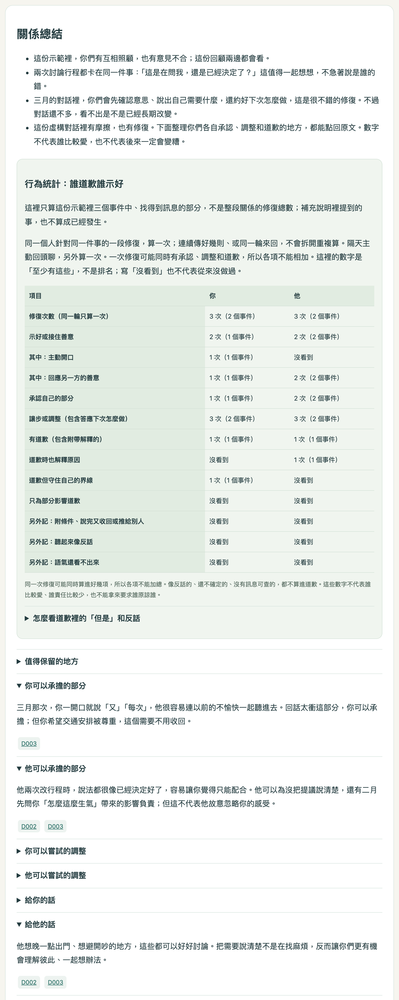
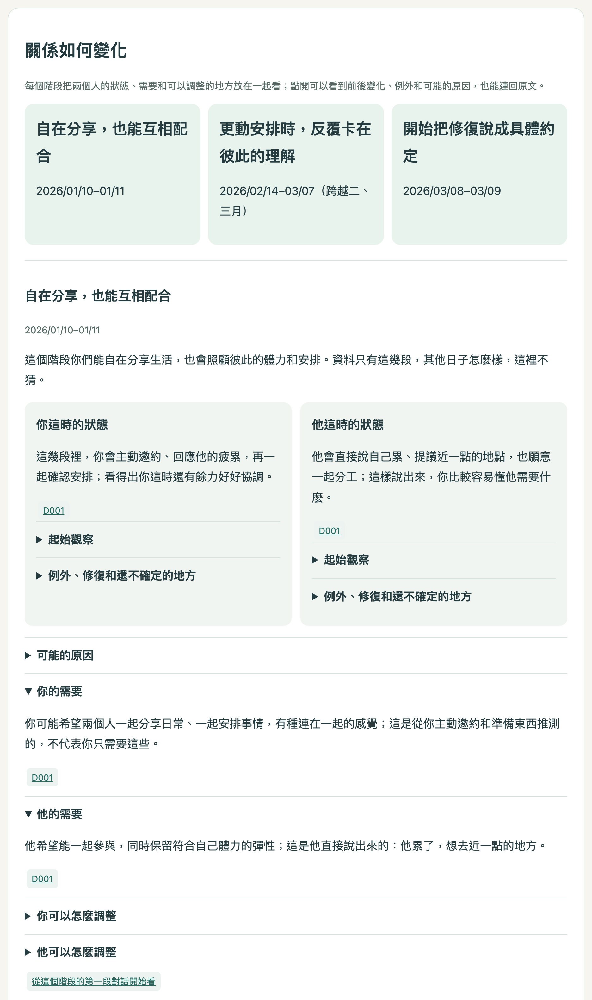
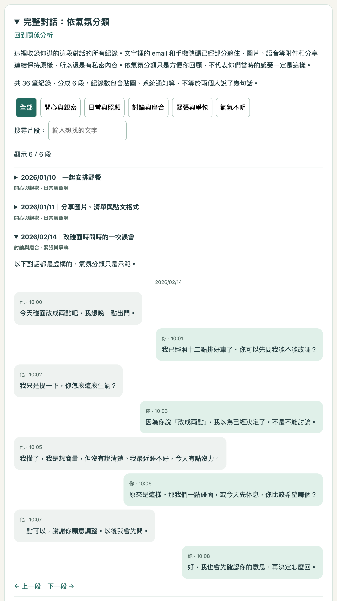

# 現代感情問題，現代手段

> AI 科技執法。

根據你丟進去的對話，分析：

- **關係的走向變化**：不同階段的雙方需求、調整方向。
- **整段關係的總結**：雙方需求、雙方責任、心理學行為延伸探討。
- **完整對話回顧**：按氣氛分類，方便重溫或清醒。
- **修復行為整理**：逐事件回查示好、承認、調整與道歉；反諷、限定條件與未知分開記錄，數量不代表誰比較愛。
- **手機閱讀導覽**：向下閱讀後可用「回本段」「回頁首」快速返回，不清除篩選或收起對話。

## 預覽

> 以下皆為虛構示範資料。新版完整範例見 [example.html](example.html)（下載後以瀏覽器開啟）。
>
> 範例包含雙方狀態與階段變化、逐事件互動反應、可回查的修復行為整理，以及手機上的「回本段」「回頁首」。數字只整理這份示範裡能確認的回合，不是感情成績單。

| 關係總結                                           | 關係如何變化                                         | 完整對話回顧                                        |
| ---------------------------------------------- | ---------------------------------------------- | --------------------------------------------- |
|  |  |  |

## 使用步驟

1. 點進 GitHub 頁面，選擇 **Code → Download ZIP**。
2. 使用電腦版 ChatGPT，切換至 **Work／工作模式**，把 ZIP 拖進對話視窗，請 ChatGPT 安裝。
3. 在同一個對話視窗輸入：
  > 請替我使用關係分析回顧對話。
   並附上匯出的聊天紀錄：
  - **LINE**：對話視窗 → 選項 → 儲存聊天。
  - **IG**：
    1. 設定 → 帳號管理中心 → 你的資訊和權限 → 匯出／下載你的資訊。
    2. 選擇你的 IG 帳號 → 匯出到裝置 → 資料種類只勾「訊息」→ 指定日期範圍 → 格式選 **JSON**。
    3. 送出申請，等待完成。
    4. 點擊下載。
4. 額外補充任何形式的資料，建議附上**日期或事件名稱**。
5. 燒錢，並做好心理準備。
6. 觀賞結果。

## 備註

- 已要求遮蔽對話文字的郵件與手機；圖片、語音等附件及分享網址保留原樣。對話不供其他用途使用、不寫入可操作的記憶層；但本身的保存、記憶與資料處理仍依各自平台行為，請斟酌使用。
- 極燒 token，斟酌使用。**情越長，價越高。**
- 可能破防，斟酌使用。

## TL;DR

- **想來點刺激**：關係總結 → 他可以嘗試的調整、他可以承擔的部分。
- **想好好過節**：關係總結 → 你可以嘗試的調整、你可以承擔的部分、這段互動值得保留的地方。
- **想再暈一下**：完整對話 → 開心與親密。
- **想狠狠下船**：完整對話 → 緊張與爭執。

